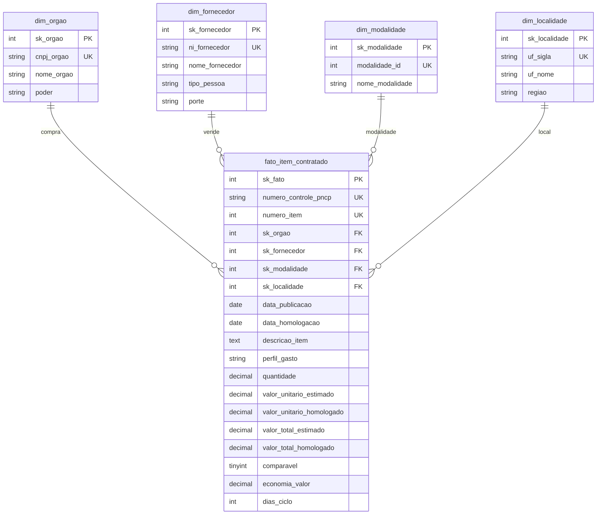
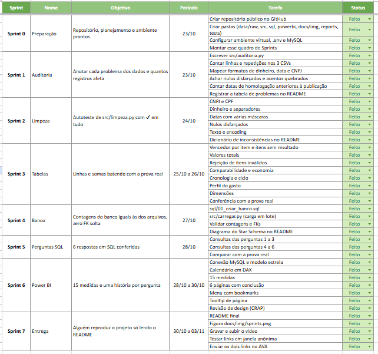

# Radar PNCP: das compras públicas bagunçadas ao dashboard da Controladoria

**Autora:** Julia Segundo (https://github.com/juliarsegundo) · Projeto final do Módulo 2, *Análise de Dados com Python* (SENAI)
**Vídeo de apresentação:** [Assistir no Google Drive](COLE_AQUI_O_LINK_DO_VIDEO)

## O problema

A Controladoria precisa entender as compras públicas federais: se há sobrepreço, se o dinheiro está concentrado em poucos fornecedores, quanto tempo os processos demoram e como as modalidades se comparam. Mas os dados que ela recebe do Portal Nacional de Contratações Públicas (PNCP) vêm sujos: CNPJ com máscara ou sem zero, valores em texto, datas em vários formatos e nulos escondidos em texto.

Este projeto monta uma esteira de ponta a ponta, que transforma esses dados brutos de **2025** (3 arquivos: 2.042 contratações, 7.077 itens e 15.896 resultados) em um painel confiável:

**CSVs brutos → Python (auditoria e limpeza) → MySQL (modelo estrela) → Power BI (dashboard)**

O painel responde a 6 perguntas: (1) quanto o governo economizou, (2) quem concentra o orçamento, (3) quais modalidades economizam mais, (4) onde as compras demoram mais, (5) como o gasto se distribui entre estados e regiões e (6) quanto vai para bens, serviços e obras.

## Estrutura do repositório

```
data/raw/        CSVs brutos (do PNCP, ano de 2025)
data/processed/  tabelas geradas pelo pipeline (não versionadas)
src/             código Python: auditoria, limpeza, montagem das tabelas e carga
sql/             criação do banco (01) e as 6 perguntas de negócio (02)
powerbi/         arquivo .pbix do dashboard
docs/img/        imagens do README (diagrama e Sprints)
reports/         relatórios gerados (ex.: auditoria dos dados)
```

## Tecnologias

Python 3.10+ com `pandas` (limpeza e transformação), `mysql-connector-python` (carga) e `pytest` (testes); MySQL e MySQL Workbench; Power BI Desktop com DAX (MySQL Connector/NET 8.x para ler o banco); Git e GitHub; planilha para planejar as Sprints.

## O que encontrei nos dados e como tratei

Antes de limpar, auditei os três arquivos com `src/auditoria.py`, que só lê e conta (relatório completo em [`reports/auditoria.txt`](reports/auditoria.txt)). Depois tratei cada problema em `src/limpeza.py`, em funções pequenas. Todo valor passa pelas mesmas etapas, nesta ordem: tirar espaços e invisíveis, consertar acento, checar nulo disfarçado e só então converter para o tipo certo. O autoteste `python -m src.limpeza` confere cada exemplo.

| Desafio | O que a auditoria achou | Como tratei e por quê | Exemplo |
| --- | --- | --- | --- |
| **1. Documentos (CNPJ/CPF)** | Máscara em 176 CNPJ de órgão e 1.631 documentos de fornecedores; espaços nas pontas em 131 e 990; zero perdido em 77 e 355; 18 documentos com letras (estrangeiros) | Mantenho só os dígitos e completo os zeros (CNPJ 14, CPF 11), para o mesmo órgão ou fornecedor não aparecer duplicado. Estrangeiros (PE) ficam como vieram | `394460000141` → `00394460000141` |
| **2. Dinheiro e números** | `R$`, espaços invisíveis e separadores misturados em 6 colunas (quantidades e valores) | Ponto ou vírgula sozinho é decimal; símbolo repetido é milhar; com os dois, o último é o decimal. Apagar todos os pontos inflaria o volume para ~R$ 31 bi em vez de ~R$ 8 bi | `0,754` → `0.754`; `1.234.567` → `1234567` |
| **3. Datas** | 7 formatos no mesmo campo (35% das datas fora do formato mais comum); 234 homologações anteriores à publicação (estimativa) | Descarto a hora, converto cada formato e aceito só anos de 2000 a 2030. Homologação anterior à publicação é impossível: fica sem data e sem ciclo, mas o item permanece | `20250310` → `2025-03-10` |
| **4. Nulos disfarçados** | `N/A`, `NULL`, `-`, `0` e `SEM INFORMAÇÃO` em colunas como `processo` (72), `situacao_item` (196) e `porte` (425) | Viram vazio, para não aparecerem como categorias falsas. O `0` só é nulo em campo de texto; em quantidade e valor é um número | `N/A` → vazio |
| **5. Texto e nomes** | 202 textos com acento quebrado em 5 colunas; 440 grafias de órgão (352 após padronizar); 539 CNPJ de órgão como vêm; 10.707 nomes de fornecedor | Conserto o acento, normalizo espaços e uso maiúsculas, para agrupar o mesmo órgão ou fornecedor | `São Carlos` → `SÃO CARLOS` |

Alguns vazios são normais e não foram tratados como erro: `data_cancelamento` vazia significa que o resultado não foi cancelado, e `ordem_classificacao_srp` vazia conta como 1º colocado. As datas com ano no fim (`10/03/2025`) foram lidas como dia/mês/ano.

## Decisões técnicas

- **Ler tudo como texto** (`dtype=str`) e converter só depois de limpar, para o pandas não "adivinhar" tipos e perder zeros à esquerda.
- **Uma linha por item na fato**, com um único vencedor por item (descarto resultados cancelados antes de escolher o 1º colocado). Itens sem resultado ou com dados impossíveis ficam de fora.
- **Economia só onde dá para comparar:** itens de Credenciamento e razões fora de 0,1 a 10 entram no volume, mas não na economia, e os percentuais são sempre soma ÷ soma.
- **Modelo estrela** (1 fato + 4 dimensões), com chaves substitutas, `UNIQUE` nas chaves naturais, `CHECK` contra valores inválidos e `DECIMAL` para dinheiro. O banco é a segunda barreira de qualidade depois do Python.
- **Linha "Não informado" (chave -1)** em cada dimensão, para nunca perder um item por falta de órgão, fornecedor, modalidade ou UF.
- **Calendário em DAX** no Power BI, sem a hierarquia automática de datas, com limites vindos dos dados e meses ordenados por número.
- **Itens rejeitados (99):** ficam fora da fato os itens com resultado que tenham quantidade vazia ou ≤ 0, valor unitário estimado ou homologado ausente ou ≤ 0, orçamento sigiloso, total estimado menor que R$ 1, total homologado mais de 1.000 vezes o estimado, ou qualquer total acima de R$ 1 trilhão. Esses itens não são carregados no banco.
- **Perfil do gasto:** um item é "Obras e engenharia" quando a descrição ou o objeto da compra contém, como palavra inteira, *obra*, *construção*, *reforma* ou *engenharia*. Nos demais casos, Material vira "Bens" e Serviço vira "Serviços".

## Modelo dimensional

Modelo implementado no MySQL (o tempo é a tabela Calendário, criada em DAX no Power BI):



## Como executar do zero

1. Clone o repositório e entre na pasta: `git clone https://github.com/juliarsegundo/projeto_final_pncp.git`
2. Crie e ative o ambiente virtual e instale as dependências:
   `python -m venv .venv`, depois `.venv\Scripts\activate` (Windows) e `pip install -r requirements.txt`
3. Copie `.env.example` para `.env` e preencha a senha do seu MySQL (o `.env` nunca vai para o GitHub). O serviço do MySQL precisa estar ligado.
4. Confira a limpeza: `python -m src.limpeza` (deve mostrar ✔ em todos os exemplos).
5. Monte as tabelas: `python -m src.montar_tabelas` (gera a fato e as 4 dimensões em `data/processed/`; a fato tem 6.126 linhas).
6. Crie o banco e carregue: `python -m src.carregar`. No fim, a conferência deve mostrar **OK** nas 5 tabelas (fato 6.126, `dim_orgao` 363, `dim_fornecedor` 2.652, `dim_modalidade` 7, `dim_localidade` 27).
7. Rode as 6 perguntas de `sql/02_perguntas.sql` no MySQL Workbench, uma consulta por vez (por exemplo, a pergunta 1 deve dar economia de 14,46%).
8. Abra `powerbi/pncp_dashboard.pbix` no Power BI Desktop (precisa do MySQL Connector/NET 8.x). Se pedir credenciais, use `localhost`, o banco `pncp_controladoria` e o usuário e a senha do seu MySQL; depois clique em **Atualizar**.

## Resultados: as 6 perguntas

Os números abaixo aparecem no dashboard e saem das consultas de `sql/02_perguntas.sql`.

| # | Pergunta | Resposta |
| --- | --- | --- |
| 1 | Quanto o governo economizou? | R$ 992,86 milhões, ou **14,46%**, sobre R$ 6,87 bi estimados nos 5.457 itens comparáveis (89,08% da fato) |
| 2 | Quem concentra o orçamento? | Os 10 maiores fornecedores levam **41,43%** do volume (R$ 3,33 bi de R$ 8,04 bi). O maior tem 13,18% num único item de R$ 1,06 bi |
| 3 | Quais modalidades economizam mais? | A Concorrência Eletrônica movimenta 58,43% do volume (economia de 14,27%); o Pregão Eletrônico economiza mais (24,02%) com 6,24% do volume; o Credenciamento (26,62%) não tem como medir economia |
| 4 | Onde as compras demoram mais? | Ciclo médio de **48,1 dias** (máximo 611); 230 itens sem ciclo. Entre órgãos com 5+ itens, a UFCG tem a maior média (266 dias) |
| 5 | Onde se gasta mais e onde há mais desconto? | Centro-Oeste concentra 44,25% do gasto (DF: R$ 3,14 bi, 38,98%); o Norte tem o melhor desconto (21,43%) e o Sul o menor (7,96%) |
| 6 | Como se divide o gasto? | Obras e engenharia 60,82% (967 itens), Serviços 36,56% (1.849) e Bens 2,63% (3.310) |

## O dashboard no Power BI

- **6 páginas**, uma por pergunta, sempre no mesmo formato: a pergunta como título, os números (cartões, gráficos e tabela) e uma conclusão minha.
- **15 medidas DAX** em uma tabela própria (`Medidas`), organizadas em pastas por pergunta, com `VAR`/`RETURN`, `CALCULATE`, `DIVIDE` e funções como `SUMX`, `RANKX` e `TOPN`. Percentual é sempre soma ÷ soma.
- **Calendário em DAX** com mês ordenado pelo número e duas relações com a fato (publicação ativa, homologação inativa).
- **Navegação:** menu retrátil com botões e bookmarks, e uma página de tooltip com os detalhes ao passar o mouse.
- **Design:** grade fixa em todas as páginas, cores com propósito (laranja só para o número principal) e as mesmas medidas do SQL.

## Planejamento em Sprints



| Sprint | Objetivo | Período | Status |
| --- | --- | --- | --- |
| 0. Preparação | Repositório, pastas e ambiente | 26/10 | Feito |
| 1. Auditoria | Anotar cada problema dos dados e quantos registros afeta | 26/10 | Feito |
| 2. Limpeza | Autoteste de `limpeza.py` com ✔ em tudo | 27/10 | Feito |
| 3. Tabelas | Fato e dimensões batendo com a prova real | 27/10 a 28/10 | Feito |
| 4. Banco | Banco carregado, contagens iguais, zero FK solta | 29/10 | Feito |
| 5. Perguntas SQL | 6 respostas conferidas | 29/10 | Feito |
| 6. Power BI | 15 medidas e uma história por pergunta | 29/10 a 03/11 | Feito |
| 7. Entrega | README, figura das Sprints e vídeo | 03/11 | Feito |

## Melhorias futuras

- Incluir outros anos e comparar a evolução da economia e do ciclo de compras.
- Separar serviços continuados de eventuais no perfil do gasto.
- Padronizar as unidades de medida (hoje são 360 grafias) para comparar preços por unidade.
- Automatizar a atualização do dashboard e acrescentar mais testes automáticos com `pytest`.

## Lições aprendidas

**O que foi mais difícil**

- **Números com separadores misturados.** Ler `0,754` ou `1.234,56` do jeito errado inflava o volume para ~R$ 31 bi em vez de ~R$ 8 bi. A regra de separadores e o autoteste do `limpeza.py` resolveram.
- **A ordem das regras de negócio.** Escolher o 1º colocado antes de descartar os resultados cancelados fazia perder cerca de 60 itens. Só quando respeitei a ordem a fato fechou em 6.126.
- **Um erro escondido no SQL.** A função que executa o script apaga tudo depois de `--`, e um valor `'--'` quebrou a criação do banco. Troquei por `'XX'`.
- **Power BI.** A relação entre fato e dimensão precisa ser "muitos para um", e um filtro Top 10 escolhido por uma medida e exibido por outra devolvia só 2 órgãos. Aprendi a conferir cada visual contra o SQL.

**O que aprendi**

- Auditar antes de limpar mostra o tamanho do problema e dá argumento para cada decisão.
- Conferir cada etapa contra um número de referência (a prova real) evita carregar erro para a etapa seguinte.
- Colocar a regra de qualidade no Python e também no banco (`UNIQUE`, `CHECK`, chaves) dá duas barreiras.
- Dashboard bom conta uma história: pergunta, número e conclusão.

**O que mudou no planejamento:** o Power BI levou mais tempo que o previsto, então a Sprint 6 foi até 03/11 e a Sprint 7 ficou comprimida no último dia. Numa próxima vez, reservaria mais tempo para o dashboard e começaria o vídeo mais cedo.
